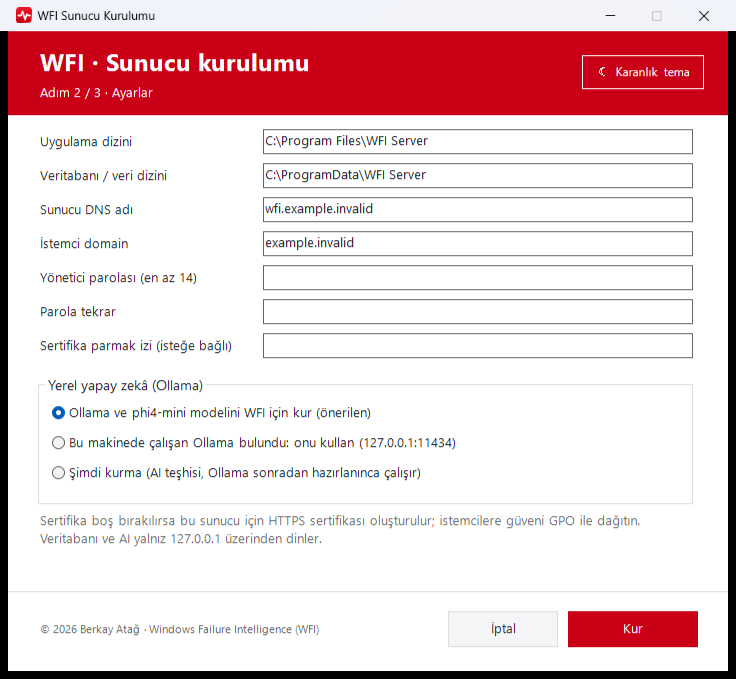
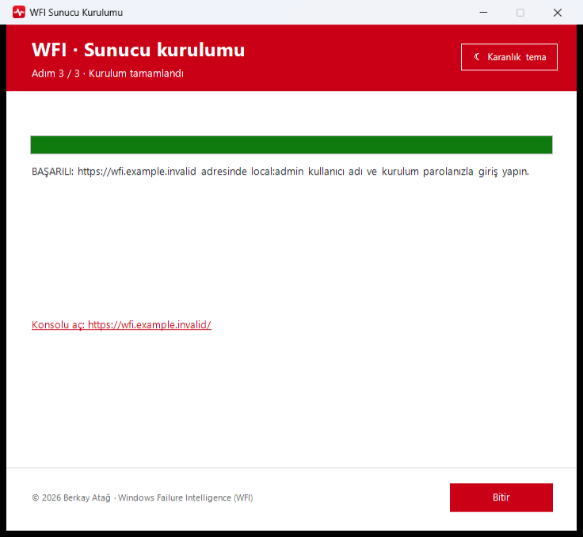
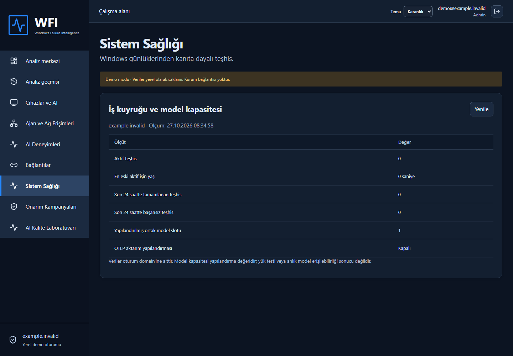
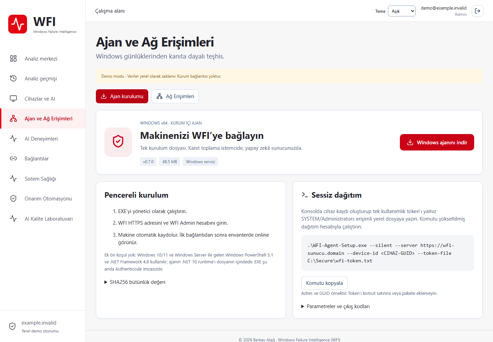
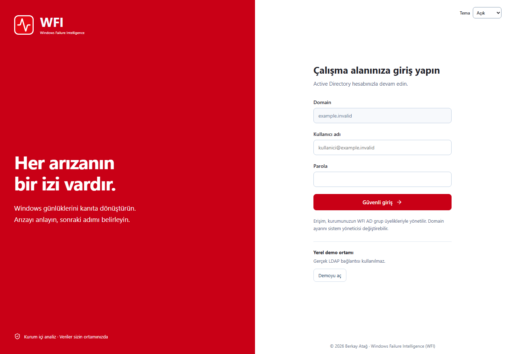
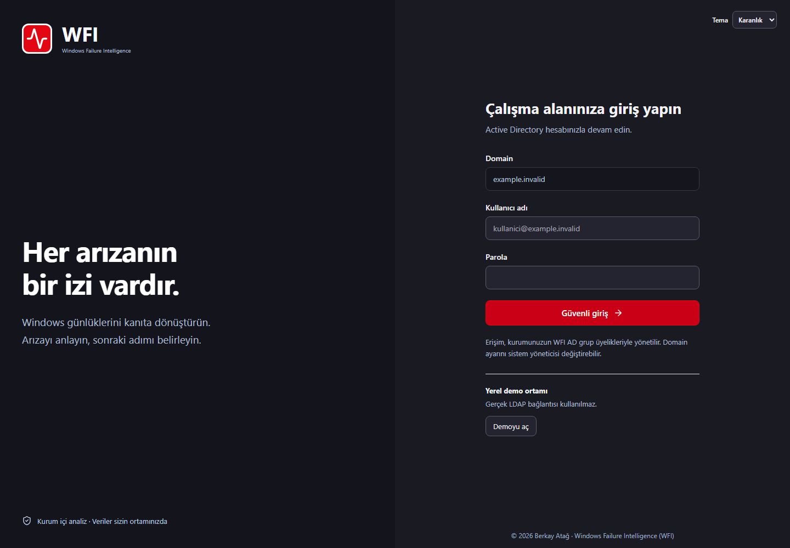

<p align="center"></p>

<h1 align="center">Windows Failure Intelligence (WFI)</h1>

<p align="center"><b>Windows sorunlarını kanıtla çözün.</b> Yerel yapay zekâ · Kontrollü onarım · Tek konsol</p>

<p align="center">
  <a href="https://github.com/BerkayAtag/Windows-Failure-Intelligence/releases/latest/download/WFI-Server-Setup.exe"><b>Sunucu kurulumunu indir (0.7.1)</b></a> ·
  <a href="https://berkayatag.github.io/Windows-Failure-Intelligence/">Tanıtım sayfası</a> ·
  <a href="docs/server-installation.md">Sunucu kurulumu</a> ·
  <a href="docs/client-installation.md">İstemci kurulumu</a> ·
  <a href="docs/firewall-requirements.md">Firewall</a> ·
  <a href="history-release.md">Sürüm geçmişi</a>
</p>

<picture>
  <source media="(prefers-color-scheme: dark)" srcset="site/assets/console-dark.png">
  
</picture>

Makineyi seçin, sorunu anlatın. WFI ajanı kanıtları toplar, sunucudaki yerel yapay zekâ (Ollama) bulguları değerlendirir; onarım onaylı işlem kataloğu ve cihaz politikalarıyla yürür. Veriler kurum içinde kalır.

## Kurulum: İleri → Kur → Bitir

1. [WFI-Server-Setup.exe](https://github.com/BerkayAtag/Windows-Failure-Intelligence/releases/latest/download/WFI-Server-Setup.exe) dosyasını Windows Server'a indirip **yönetici olarak çalıştırın**.
2. **İleri**: sihirbaz Windows temanıza göre aydınlık veya karanlık açılır, sağ üstteki düğmeyle değiştirilebilir. Dizinleri, sunucu DNS adını, istemci domain'ini ve `local:admin` parolasını (en az 14 karakter) girin. **Yerel yapay zekâ** için seçim yapın:
   - Makinede Ollama yoksa **Ollama ve phi4-mini modelini WFI için kur** (varsayılan),
   - 127.0.0.1:11434'te çalışan bir Ollama varsa **mevcut Ollama'yı kullan**,
   - ya da **şimdi kurma**.
3. **Kur**: IIS, .NET 10 Hosting Bundle, VC++ çalışma zamanı, PostgreSQL 17 (yalnız 127.0.0.1), HTTPS sertifikası, `WFI-HTTPS` güvenlik duvarı kuralı ve veritabanı şeması otomatik hazırlanır. İndirilen her paket SHA ile doğrulanır.
4. **Bitir**: **Konsolu aç** bağlantısıyla `https://<sunucu>` adresine gidin, `local:admin` ve parolanızla giriş yapın. LDAP/Active Directory sonradan etkinleştirilebilir.

| Ayarlar ve Ollama seçimi | Kurulum tamamlandı |
|---|---|
| <picture><source media="(prefers-color-scheme: dark)" srcset="site/assets/setup-wizard-dark.png"></picture> | <picture><source media="(prefers-color-scheme: dark)" srcset="site/assets/setup-finish-dark.png"></picture> |

Kurulum sihirbazı ve ajan kurulumu Windows temanızı izler (aydınlık/karanlık, düğmeyle değiştirilebilir). Programlar ve Özellikler'de **WFI Server**, yayıncı **Berkay Atağ**, sürüm **0.7.1** ve kırmızı WFI simgesi görünür. İlk kurulum internetten birkaç GB indirir. Yarıda kalırsa (ör. yeniden başlatma gerekirse) kurucuyu aynı ayarlarla tekrar çalıştırın; tamamlanan adımlar tekrarlanmaz. Ayrıntı: [sunucu kurulumu](docs/server-installation.md).

**İstemci ajanı** GitHub'da ayrı dosya olarak yayımlanmaz: konsolda **Ajan ve Ağ Erişimleri → Windows ajanını indir** ile tek EXE alınır. Ek ön koşul yoktur (Windows PowerShell 5.1 yeterli); makine Admin hesabıyla otomatik kaydolur. Ayrıntı: [istemci kurulumu](docs/client-installation.md).

## Ekranlar

| Sistem Sağlığı | Ajan ve Ağ Erişimleri |
|---|---|
| <picture><source media="(prefers-color-scheme: dark)" srcset="site/assets/health-dark.png"></picture> | <picture><source media="(prefers-color-scheme: dark)" srcset="site/assets/agents-dark.png"></picture> |
| **Giriş (aydınlık)** | **Giriş (karanlık)** |
|  |  |

Ekranlar sentetik demo verisiyle gerçek uygulamadan alınmıştır. Konsolda Standart, Açık ve Karanlık tema bulunur; tercih hatırlanır. Mobil görünüm desteklenir.

## Özellikler

- **Makineden teşhis:** Windows olayları, servisler, BigFix ve SCCM bulguları ajan tarafından toplanır; log yükleme isteğe bağlıdır.
- **Kurum içi AI:** Ollama sunucuda çalışır (varsayılan phi4-mini). Yanıt JSON şemasıyla Türkçe alınır: özet, en fazla 3 hipotez, kanıt atfı, doğrulama adımları, eksik kanıt ve yalnız izinli katalog önerileri. Doğrulanmış geçmiş deneyimler bağlam sağlar; model ağırlıkları yeniden eğitilmez. Operatör "Çözüldü / Çözülmedi" geri bildirimi verir; AI Kalite Laboratuvarı modeli 40 sentetik vakada ölçer.
- **Kontrollü onarım:** serbest AI komutu çalıştırılmaz. Sabit katalog, önkontrol/işlem/doğrulama, yüksek risk için Admin onayı; **Onarım Otomasyonu** pilot grubu, bakım aralığı ve belirsiz sonuçta duraklatma.
- **Erişim:** `local:admin` veya LDAPS ile Viewer/Analyst/Admin grup eşlemesi; tüm veriler oturumun domain'iyle sınırlı, işlemler denetim kaydında.
- **İşletim:** Sistem Sağlığı, model kapasite slotu, BigFix merkez doğrulaması, AI Kalite Laboratuvarı.
- **Ağ:** ajan yalnız dışarı yönlü HTTPS 443 kullanır, istemcide inbound port açılmaz. PostgreSQL ve Ollama yalnız loopback'te dinler.

## Mimari

```
Windows ajanı ──HTTPS 443──▶ WFI API + worker (IIS) ◀──HTTPS 443── Operatör (tarayıcı)
                                   │
                     127.0.0.1 ────┼──── PostgreSQL 17
                                   └──── Ollama (phi4-mini)
```

ASP.NET Core 10, React/TypeScript, PostgreSQL (geliştirmede SQLite), Ollama. Ayrıntı: [mimari](docs/architecture.md), [güvenlik incelemesi](docs/security-review.md), [tehdit modeli](docs/threat-model.md).

## Geliştirme

.NET 10 SDK, Node.js 22+ ve pnpm 11 gerekir. Proje kökünde:

```powershell
./scripts/Build.ps1      # testler, web arayüzü, yayımlama ve setup EXE'leri
./scripts/Start-Demo.ps1 # http://127.0.0.1:5080 → "Demoyu aç" (yalnız Development/loopback)
```

Demo yalnız sentetik veri içindir. Üretimde şema kurulum sırasında uygulanır; uygulama başlangıcında migration çalışmaz. Ayrıntı: [yerel test](docs/local-testing.md).

## Doğrulama ve sınırlar

0.7.1 sonuçları ve açık kabul maddeleri: [doğrulama](docs/verification-current.md), [kabul matrisi](docs/acceptance-matrix.md). EXE'ler Authenticode imzalı değildir; yayıncı adı Programlar ve Özellikler kaydıdır. Gerçek Windows Server VM kurulum/kaldırma, gerçek AD/BigFix, HA ve 40.000 cihaz kapasitesi bu sürümde ölçülmedi; sıfır hata veya güvenlik açığı iddiası yoktur. Önceki sürüm notları: [arşiv](docs/release-notes-archive.md).

---

<p align="center">© 2026 Berkay Atağ · Windows Failure Intelligence (WFI)</p>
