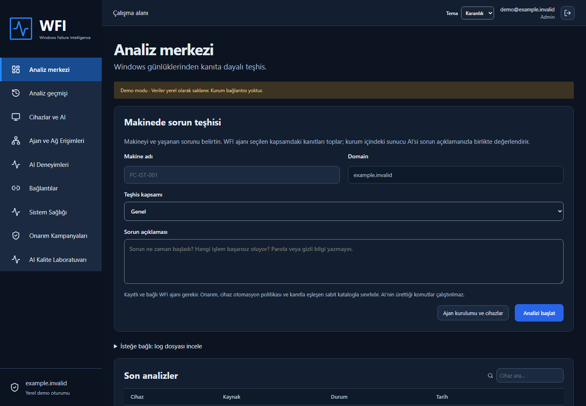

# Windows Failure Intelligence

PostgreSQL varsayılan 55432 portu Windows tarafından ayrılmış veya doluysa kurucu 35432–35531 aralığından uygun bir loopback portunu otomatik seçip yapılandırmaya kaydeder; ağdan DB erişimi açılmaz.

Önceki preview.4/5 kurucuları yerine preview.6 kullanın. Kurulum düzeltmesi: Windows PowerShell 5.1 altında SQL UTF-8 olarak okunur ve PostgreSQL istemci kodlaması UTF8 seçilir; Türkçe katalog metinleri korunur. DNS sorgusu başarısızsa sihirbaz makine adıyla açılır. Sunucunun DNS domain bilgisi varsa domain alanına otomatik alınır ve değiştirilebilir.

**0.6.0-preview.6 · Kırmızı-beyaz tasarım, karanlık tema ve Onarım Otomasyonu.**

[Tanıtım sitesi](https://BerkayAtag.github.io/Windows-Failure-Intelligence/) · [Sunucu kurulumu](https://github.com/BerkayAtag/Windows-Failure-Intelligence/releases/tag/v0.6.0-preview.6) · [Kurulum](docs/server-installation.md) · [Firewall](docs/firewall-requirements.md)

Sunucu kurulumu: **WFI-Server-Setup.exe → Yönetici olarak çalıştır → İleri → parola belirle → Kur → Bitir**. Varsayılanda IIS, .NET Hosting Bundle, PostgreSQL ve Ollama/model otomatik hazırlanır. Veri dizini değiştirilebilir. İlk giriş **local:admin**, parola kurulumda belirlediğiniz paroladır; LDAP sonradan etkinleştirilir. İlk kurulum internetten birkaç GB indirir; tamamen çevrimdışı paket değildir. Yeniden başlatma istenirse Windows'u yeniden başlatıp aynı ayarlarla kurucuyu tekrar açın.

Geliştirme önizlemesi; gerçek Windows VM kurulum kabulü henüz yapılmadı. EXE'ler imzasızdır. Otomatik kurucu yeni, tek sunuculu pilot içindir; HA/yükseltme ayrı bakım prosedürüdür. Şema kurulum sırasında uygulanır; uygulama başlangıcında migration çalışmaz. GitHub Pages yalnız statik tanıtımdır; kurum verisi GitHub'a gönderilmez.

Bu sürümde 220 .NET ve 14 Playwright testi; gerçek PostgreSQL üzerinde 3 kabul testi geçti. Gerçek Windows VM kurulum/yükseltme, AD/BigFix, HA ve 40 bin aktif cihaz yük kabulü açık. Ayrıntı: [doğrulama](docs/verification-current.md), [uygulama durumu](docs/implementation-roadmap.md).

---
# Windows Failure Intelligence (WFI)

## 0.6.0-preview.1 — 26 Ekim 2026 (geliştirme önizlemesi)

- Birleşik ajan check-in, uyarlanabilir bekleme ve PostgreSQL ortak model slotu/fencing; Sistem Sağlığı ve isteğe bağlı OTLP.
- Sabit hedefli onarım kampanyaları; pilot, bakım aralığı, paralellik, ayrı genişletme onayı ve başarısız/belirsiz sonuçta duraklatma.
- Salt okunur BigFix merkez eşleme/rapor doğrulaması. API kesintisi yerel arızadan ayrı; onarım sonrası veri öncesi baseline olarak kullanılmaz.
- AI Kalite Laboratuvarı, 40 sentetik vaka varyantı, 80 geçmiş açık/kapalı değerlendirme; operatör geri bildirimi ve negatif deneyim veto filtresi.
- Eski demo veritabanında JSON sürüm alanı yükseltme hatası düzeltildi; analiz verisinin korunması ve tekrar yükseltme test edildi. Readiness yeni şemayı denetler.
- AI model-listesi hatasının başarılı liste yenilemesiyle gizlenmesi düzeltildi; geçersiz model adresinde kesintiden dönen iş bloke edilir.
- Bu önizleme imzasızdır; 5–10 numaralı yol haritası geliştirmeleri ve gerçek kurum kabulü tamamlanmadı. Detay: docs/implementation-roadmap.md ve docs/operations-0.6.md.

## 0.5.0 — tek EXE, ağ kuralları ve deneyim hafızası

Sol menüde **Ajan ve Ağ Erişimleri** bulunur. Ajan kurulumu sekmesi tek `WFI-Agent-Setup.exe`, sürüm/boyut/SHA256 ve sessiz kurulum seçeneklerini sunar. **Ağ Erişimleri** sekmesi kaynak–hedef–port gereksinimlerini gösterir; canlı bağlantı testi değildir. Eski envanter içi indirme bağlantısı kaldırıldı.

İndirilen EXE tüm ajan/kurucu dosyalarını içerir. Yükseltilmiş çalışmada yükünü Program Files altında yalnız SYSTEM/Administrators erişimli geçici dizine açar ve kurucuyu başlatır. Kurulan Windows servisinin bağımlılık dosyaları kendi dizininde bulunur; tek EXE, dağıtılan kurulum dosyasıdır. PowerShell 7 x64 ve Windows .NET Framework 4.8 gerekir; ajan .NET 10 runtime'ı gömülüdür. Kurum dağıtımı için EXE Authenticode ile imzalanmalıdır.

**AI Deneyimleri**: aynı domain, mevcut kanıta uyan katalog ve aynı teşhis kapsamındaki başarılı/ajan doğrulamalı geçmiş işlemlerden en fazla 5 örnek modele sunulur. Bu bir erişimli deneyim hafızasıdır; model ağırlıklarını yeniden eğitmez. Geçmiş metin komut veya otomatik onarım yetkisi olmaz. Admin deneyimi gelecek kullanımdan çıkarabilir; audit kaydı tutulur. [AI öğrenme rehberi](docs/ai-learning.md).

Dağıtım: `artifacts/WFI-0.5.0-pilot.zip`. Üretimde önce VerifiedExperienceMemory migration'ı veya güncel deploy/schema.sql uygulanır; uygulama başlangıcında otomatik migration yoktur.

## 0.4.1 — ajan setup ve otomatik envanter

Ana sayfadaki kapsam etiketi artık yalnız **Genel**. BigFix ayrı seçenek olarak da korunur; Genel'in kanıt toplama kapsamı değişmedi.

Admin konsolunda **Ajan ve Ağ Erişimleri → Ajan kurulumu** ile tek **WFI-Agent-Setup.exe** dosyasını indirin ve çalıştırın. Pencerede HTTPS sunucu adresi ve WFI Admin hesabı girilir. Setup makine adını otomatik alır, sunucuda kayıt açar ve ajan servisini kurar. Önceden DeviceId/token oluşturmak gerekmez. Kayıt domain'i doğrulanmış Admin oturumundan gelir. İlk kayıt “pending”, ajan bağlantısı sonrası “online” görünür; açık envanter yaklaşık 10 saniyede yenilenir.

Ajan ve setup .NET runtime'larını paketler; istemcide ayrıca .NET kurulumu gerekmez. **PowerShell 7 x64** ön koşuldur. Parola dosyaya veya komut satırına yazılmaz. Mevcut ajan yükseltmesi/kısmi kurulum kurtarması için [istemci rehberi](docs/client-installation.md). Kurulum EXE'si Authenticode imzalı değildir; kurum dağıtımı için kod imzalama ve Windows test makinesinde kabul gerekir.

## 0.4.0 — makineden teşhis ve BigFix

Analiz merkezi artık makine adı, oturum domain'i, kapsam ve sorun açıklaması alır. Kayıtlı ajan kanıt toplar; AI yalnız sunucuda çalışır. Genel kapsam BigFix BESClient durumunu ve standart konumdaki bugünkü BigFix logunun sınırlı kuyruğunu da toplar. Ayrı BigFix kapsamı vardır. Log yükleme isteğe bağlı kapalı bölümde korunur.

Admin, **Ajan ve Ağ Erişimleri** menüsündeki indirme bağlantısını kullanabilir. Paket sır içermez; kayıt token'ı kurulum sırasında ayrı girilir. BigFix otomatik onarımı cihaz politikası açıkken, başarılı AI analizi ve gerçek servis kanıtı eşleşmesiyle çalışır. Önce servis başlatılır; başarısızsa onaylı SHA256 ile `C:\Windows\Bigfix\Cache\reinstall.cmd` en fazla 15 dakikalık toplam işlem süresinde denenir. Servis Running doğrulaması yönetim sunucusuna erişimin kanıtı değildir.

Sunucu paketi `artifacts/WFI-0.5.0-pilot.zip`; açıldıktan sonra **Setup-Server.cmd** dosyasını yönetici olarak çalıştırın. Ön koşullar ve sınırlar: [sunucu kurulumu](docs/server-installation.md). Ajan: [istemci kurulumu](docs/client-installation.md). [Firewall](docs/firewall-requirements.md), [yerel test](docs/local-testing.md), [BigFix](docs/bigfix.md).

**0.3.0 pilot:** Yapılandırılabilir AD/LDAPS girişi, Windows log analizi, Windows ajanı, sunucu Ollama modeli ve kontrollü uzaktan düzeltme. ASP.NET Core 10, React/TypeScript, PostgreSQL; geliştirmede SQLite. Varsayılan domain example.invalid, ayarlardan değiştirilebilir.

[Sunucu kurulumu](docs/server-installation.md) · [İstemci kurulumu](docs/client-installation.md) · [Firewall](docs/firewall-requirements.md) · [Load balancer](docs/load-balancer.md) · [Kapasite](docs/capacity.md) · [Sürüm geçmişi](history-release.md) · [Güvenlik](docs/security-review.md) · [Uygulama notları](docs/agent-ollama-implementation.md) · [Skill'ler](docs/skills.md)

## Özellikler

- AD hesabıyla LDAPS giriş; Viewer/Analyst/Admin grup eşlemesi, domain bazlı erişim. Domain/DC/Base DN/grup DN'leri sunucu ayarıdır.
- Standart, Açık, Karanlık tema; mobil düzen, sayfalı analiz ve cihaz listeleri.
- ZIP/XML/LOG/TXT yükleme, yedi kanıt kuralı, kalıcı analiz kuyruğu, mükerrer dosya kontrolü ve audit.
- Cihaz kaydı, tek kullanımlık enrollment ve outbound HTTPS Windows servisi; sınırlı kanıt toplama, DPAPI korumalı kalıcı kimlik.
- **Cihazlar ve AI**: kurulu Ollama modelini seçme, uzaktan teşhis, hipotez/öneri, manuel düzeltme, cihaz/genel otomatik mod. Varsayılan model phi4-mini:latest; model sunucuda çalışır.
- Serbest AI komutu çalıştırılmaz. Sabit katalog, önkontrol/işlem/doğrulama, cihaz/lease bağlı sonuç ve tekrar yürütmeyi önleyen journal.
- Ortak PostgreSQL, korumalı key ring ve ortak storage ile çoklu API düğümü yapılandırması; ayrı worker ve migration SQL.

## Yerel çalıştırma

PowerShell'de proje kökünden önce scripts/Build.ps1, sonra scripts/Start-Demo.ps1 çalıştırın. http://127.0.0.1:5080 → **Demoyu aç**. Demo yalnız Development/loopback içindir; gerçek kurum verisi kullanmayın.

Derleme için .NET 10 SDK, Node.js 22+ ve pnpm 11 gerekir. Betikler sistem dotnet yoksa %LOCALAPPDATA%/WFI/dotnet yolunu dener. Üretimde Node gerekmez. scripts/Package.ps1 API, worker, Windows ajanı, örnek ayarlar, betikler ve belgeleri artifacts/WFI-0.3.0-pilot.zip olarak paketler; MSI değildir.

## Şirket kurulumu

1. PostgreSQL, HTTPS/IIS ve kurum CA güvenini hazırlayın. deploy/appsettings.example.json dosyasını API yanında appsettings.local.json olarak yapılandırın; sırları depoya koymayın.
2. Gerçek LDAPS DC FQDN, Base DN ve rol grup DN'lerini girin. Ldap.Domain değiştirilebilir; giriş ekranı buradan okur. Kullanıcı kısa ad veya UPN ile giriş yapar.
3. Yedekten sonra dotnet WFI.Api.dll --migrate veya aynı sürümün deploy/schema.sql dosyasını ayrı DDL hesabıyla uygulayın. Production başlangıcı şemayı otomatik değiştirmez.
4. Ollama modelini sunucuda hazırlayın; API ve worker aynı model servisini kullanmalıdır. Arayüzde Admin model seçebilir. OpenAI API anahtarı gerekmez.
5. Küçük pilot grubundaki cihazları kaydedip istemci rehberindeki servis kurulumunu uygulayın. Manuel kabulden sonra otomatik mod değerlendirilir.

## Doğrulama ve sınırlar

[Güncel doğrulama](docs/verification.md). Gerçek yerel phi4-mini ile sentetik teşhis hattı doğrulandı; gerçek işletim sistemi onarımı çalıştırılmadı. LDAP kurum kabulü, yönetici haklı Windows servis kurulum kabulü, gerçek PostgreSQL/LB failover ve 40.000 ajan yükü henüz doğrulanmadı. Yeni Codex Security taraması başlatma dosya-okuma hatası aldı; eski rapor yeni ajan kodunun güvenlik onayı değildir.

40.000 yönetilen cihaz hedefi, eşzamanlı 40.000 bağlantı veya tek Ollama'nın tüm filoya yetişmesi garantisi değildir. Kapasite planı uygulanmadan filo otomatik modu açılmamalıdır. Sıfır hata/güvenlik açığı iddiası yoktur.

Tam incident yaşam döngüsü, OU/cihaz bazlı operatör erişimi, MFA/SSO, otomatik retention, SCCM/BigFix yönetim sistemi entegrasyonu ve imzalı MSI dağıtımı pilot dışındadır. Ajan yerel SCCM loglarını okuyabilir. AI'ya sınırlı maskelenmiş kanıt gönderilir; maskeleme tam DLP değildir.

Son kesinti testleriyle toplam **141 .NET testi** geçti. Ajan yükseltmesi cihaz kimliğini/sunucu adresini korur; isteğe bağlı -PollSeconds parametresi ve mevcut aralığın korunması istemci rehberinde açıklanır.

Build/demo betikleri runtime-only dotnet yerine .NET 10 SDK bulunan kurulumu seçer. PowerShell iptal ve aşırı çıktı senaryoları gerçek zararsız komutlarla doğrulandı; 4 tarayıcı testi yeniden geçti.

Ollama model keşfi kesintisi/bozuk yanıtı envanteri engellemez; arayüz bağlantı uyarısı gösterir ve geçersiz model seçimini kapatır.

Teşhis iptali ve düzeltme onayı atomik durum geçişleriyle korunur; eşzamanlı onay ve geç AI sonucu için regresyonlar eklendi. Dört tarayıcı testi yüksek risk yönetici onayını da kapsayarak geçti.

Cihaz envanteri aynı heartbeat zamanında cihaz kimliğiyle kararlı sıralanır; arama 63 karakterle sınırlıdır. 40.000 sentetik cihazla sayfalama/domain ayrımı testi geçti. PostgreSQL için DeviceInventoryPaging migration'ı ve deploy/schema.sql birlikte güncellendi; bu sonuç gerçek filo kapasitesi değildir.

Model seçimi ve domain otomatik modunun ilk kaydı veritabanında atomik ekleme/güncelleme kullanır. Cihaz otomatik modu audit kaydıyla aynı transaction içinde saklanır; audit hatasında ayar geri alınır.

Operatörler Cihazlar ve AI → Son teşhisler bölümünden aktif teşhisi iptal edebilir. Hata/iptal açıklaması listede görünür; iptal tamamlanmış düzeltmeleri geri almaz.

Ajan düzeltme yürütme süresi, katalog timeout'u ile sunucunun atama son kullanma süresinden kısa olanıyla sınırlandırılır; boş iş/lease kimliği reddedilir.

Yerel PostgreSQL 17.11 üzerinde EF migration, idempotent deploy SQL ve eşzamanlı düzeltme sahiplenme için **2/2 ek test** geçti. Çalıştırma ve kapsam: [PostgreSQL doğrulaması](docs/postgresql-validation.md). Bu testler HA/failover veya filo kapasitesi kabulü değildir.

PostgreSQL kabul senaryoları artık iki bağımsız servis örneğiyle eşzamanlı ilk model tercihini, sonraki tercihin görünürlüğünü ve geçersiz modelin mevcut ayarı korumasını da kapsar.

Hedeflerin mevcut kanıtları ve eksik kabul adımları [kabul matrisi](docs/acceptance-matrix.md) içinde izlenir; pilot paket üretim tamamlanma onayı değildir.

PostgreSQL destekli API regresyonları Viewer/domain sınırlarını, tüm cihazlara uygulamayı ve audit yazımı reddedildiğinde politika/cihaz istisnasının geri alınmasını kapsar. Kimlik doğrulayıcısı sentetiktir; gerçek AD kabulü değildir.

Ortak PostgreSQL/key dizini kullanan iki bağımsız TestServer API örneğinde oturum paylaşımı ve logout iptali doğrulandı. İlk host kapatıldığında ikinci host okumaları sürdürdü; bu, gerçek proxy/TLS/HA failover kabulü değildir.

İki API host'u ortak oturum/logout testi artık farklı loopback TCP portlarında Kestrel kullanır. İlk dinleyicinin kapanışı bağımsız HTTP istemcisiyle doğrulanır; ikinci host hizmeti sürdürür. Ayrı process, proxy ve TLS kabulü hâlâ açık.

Yerel kabul artık derlenmiş API'nin iki ayrı dotnet sürecinde ortak oturum/logout davranışını da doğrular. Bir süreç sonlandırıldığında diğer süreç çalışmayı sürdürdü. Aynı bilgisayar, loopback ve Development/demo kullanılır; Production TLS/proxy/AD kabulü değildir.

Yerel YARP proxy ile tek adres üzerinden iki API'ye dağıtım, API süreci kapanınca kalan düğüme yönlendirme ve logout doğrulandı. Sağlık tespiti sırasında geçici 502/503 mümkündür; üretim TLS/HA SLA onayı değildir.

Manuel teşhis isteği, cihazda pending/running/evidence_received/analyzing işi varken 409 döndürür. Eşzamanlı istekler cihaz satırı transaction kilidiyle sıralanır; önce mevcut işi tamamlayın veya iptal edin.

### Teşhis kabul sınırı — 2026-10-24
Domain başına aktif teşhis sınırı eklendi (varsayılan 1000). Manuel/yeniden analiz dolu kuyrukta 429, otomatik tarama gecikmeli yeniden deneme kullanır. Tüm API düğümlerinde aynı Diagnostics__MaxActivePerDomain değeri gerekir. Yeni port veya istemci kurulumu değişikliği yoktur; mevcut HTTPS ve API–PostgreSQL bağlantıları kullanılır. Ayrıntılar: [Teşhis kabul sınırı](docs/diagnostic-admission.md). Gerçek AD/üretim HA ve 40.000 aktif istemci kabulü henüz yapılmadı.

### AI yeniden analiz çakışması düzeltmesi
Eski teşhisin yeniden analizi, aynı cihazda pending/running/evidence_received/analyzing iş varsa 409 ile reddedilir. Kontrol domain transaction kilidi içinde manuel/otomatik kabul ile sıralanır. Kabul edilen yeniden analiz eski CompletedAt değerini temizler. Şema, port ve ajan kurulum gereksinimleri değişmedi.

### Ajan kanıt teslimi sınır testleri
Sentetik regresyonlar; süresi dolan lease, iptal edilmiş teşhis ve başka cihazın lease'iyle kanıt gönderimini kapsar. Bu talepler 409 ile reddedilmeli, kanıt ve audit kaydı oluşturmamalıdır. Süresi dolan iş yeniden atandığında eski lease geçersiz kalır; yeni lease ile teslim tek audit üretir. Uygulama davranışı, şema ve ağ/kurulum gereksinimleri değiştirilmedi.

### Düzeltme kuyruğunda bekleme hatası — 2026-10-25
İlk 10 bekleyen iş politika veya katalog nedeniyle uygun olmadığında sonraki geçerli manuel iş seçilemiyordu. Uygunluk filtresi artık sorgunun limitinden önce uygulanır; sıralama zaman ve iş kimliğiyle kararlıdır. Kapalı otomatik işler çalıştırılmaz ve silinmez; politika tekrar açıldığında uygun olabilir. Şema, firewall portları ve ajan kurulum adımları değişmedi.

### Ajan servis yükseltme önkontrolü — 2026-10-25
Install-Agent.ps1 mevcut servisin LocalSystem hesabını ve seçilen kurulum dizinindeki WFI.Agent.exe yolunu token isteminden, servis durdurmadan ve dosya değişikliğinden önce denetler. Özel hesap, ek komut argümanı, farklı binary yolu veya okunamayan servis yapılandırması reddedilir. Böyle bir kurulumda hesabı zorla değiştirmeyin: DPAPI state ve mevcut servis yapılandırmasını koruyan ayrı bakım planı hazırlayın. Yeni firewall portu veya sunucu şeması değişikliği yoktur. Test-AgentInstaller.ps1 altı sentetik önkontrol senaryosunu servis değiştirmeden çalıştırır ve Build.ps1'e dahildir; gerçek LocalSystem servis kabulü yerine geçmez.

### AI değerlendirmesinde kanıt ve belirsizlik — 2026-10-25
Teşhis sonucu ekranı modelin bildirdiği güveni, eksik kanıtları, hipotez kanıt atıflarını ve önerilen doğrulama adımlarını gösterir. Güven değeri ölçülmüş doğruluk/başarı olasılığı değildir; eksik veya geçersiz değer için yüzde uydurulmaz. Boş eksik-kanıt listesi tamlık garantisi olarak gösterilmez. Model metni düz React metni olarak görüntülenir; doğrulama adımları otomatik komut olarak çalıştırılmaz. Yeni endpoint, port, şema veya ajan ayarı yoktur.

### PostgreSQL büyük envanter doğrulaması — 2026-10-25
Kabul paketine 40.000 sentetik cihaz içeren PostgreSQL envanter senaryosu eklendi. Aynı heartbeat zamanında kimlikle kararlı sıralama, ilk/orta/son sayfalar, 50 kayıt sınırı, domain ayrımı, arama normalizasyonu ve listeden büyük/özel alanların çıkarılması sınanır. EF migration ve schema.sql yollarının ikisinde de çalışır. Tek kullanıcı ve TestServer API çağrıları kullanır; 40.000 aktif ajan, eşzamanlı trafik, ağ/TLS/LDAP veya üretim kapasitesi ölçümü değildir. Ürün davranışı, şema, kurulum ve firewall gereksinimleri değişmedi.

### Başlamamış düzeltmeyi iptal etme — 2026-10-25
Analyst/Admin kendi domain'indeki Approved veya PendingApproval düzeltme isteğini Düzeltme geçmişi → Bekleyen düzeltmeyi iptal et ile Cancelled durumuna alabilir. Viewer ve başka domain erişimi reddedilir. API: POST /api/v1/remediations/{id}/cancel; CSRF gerekir. Koşullu durum güncellemesi ve audit aynı transaction'dadır; iptal edilmiş iş ajana verilmez ve yeniden onaylanamaz. Ajan işi önce almışsa 409 döner; Executing/Unknown/Success/Failed durumları değişmez. İptal işletim sistemi rollback'i değildir. Otomatik işi iptal etmek otomatik politikayı kapatmaz veya 24 saatlik beklemeyi sıfırlamaz; ileride uygun yeni iş oluşabilir. Kalıcı durdurma için cihaz/genel otomatik modu kapatın. Yeni port, şema veya ajan kurulumu değişikliği yoktur.

### Bağlantı önkontrolü — 2026-10-25
Test-WfiConnectivity.ps1 eklendi: parola kullanmadan DNS, HTTPS health ve readiness yanıtlarını kontrol eder. Sertifika doğrulaması korunur; redirect/HTML başarı sayılmaz; hiçbir sistem ayarı değiştirilmez. Kullanım: [Bağlantı önkontrolü](docs/connectivity-preflight.md). Mevcut DNS ve WFI HTTPS portu kullanılır; ek firewall izni gerekmez. AD/model/ajan/HA/kapasite kabulü yerine geçmez.

### Yinelenen manuel düzeltme isteği — 2026-10-25
Aynı cihaz/katalog işlemi PendingApproval, Approved veya Executing durumundayken yeni manuel istek 409 ve mevcut iş ID'siyle reddedilir. Cihaz satırı transaction kilidi eşzamanlı manuel istekleri sıralar; revoked cihaz yeniden kontrol edilir. İş ve audit birlikte kaydedilir. İptal edilmiş işin yerine yeni istek verilebilir; Unknown sonucu olan cihazda yeniden onarım öncesi operatör incelemesi gerekliliği devam eder. Bu kontrol tamamlanmış işlemlere karşı kalıcı idempotency anahtarı değildir. Yeni şema/port/ajan kurulumu gerektirmez.

### Eski/belirsiz düzeltmenin otomatik tekrarını engelleme — 2026-10-25
Otomatik karar, manuel isteklerle ortak cihaz satırı kilidini aldıktan sonra güncel cihaz politikasını ve mevcut işleri kontrol eder. Aynı katalog işlemi PendingApproval/Approved/Executing/Unknown durumundaysa 24 saatten eski olsa da otomatik tekrar oluşturulmaz. Son 24 saat filtresi ve cihaz bekleme süresi korunur. Tamamlanmış veya iptal edilmiş eski iş, diğer koşullar sağlanırsa gelecekte yeni otomatik işe engel değildir. Unknown durumunda cihazın gerçek sonucunu inceleyin; bu durum otomatik başarı veya rollback değildir. Yeni şema, port veya ajan kurulum gereksinimi yoktur.

### AD kabul planı — 2026-10-25
Kaynak incelemesiyle docs/ad-acceptance.md eklendi. Kısa adın UPN'e çevrilmesi (ayrı sAMAccountName araması yapılmaması), alternatif suffix/NetBIOS sınırı, nested/primary grup davranışı, grup türü zorlamasının bulunmaması ve mevcut oturumun grup değişikliğinde hemen iptal olmaması açıklandı. Gerçek AD test sonucu üretilmedi; kurum ortamı hazır olduğunda uygulanacak kabul matrisi hazırlandı. Uygulama kodu/port/şema/kurulum değişmedi.

### AD security-group tür kontrolü — 2026-10-25
Önceki incelemede belirtilen tür kontrolü eksikliği giderildi. Üye olunan eşlenmiş grubun groupType security-enabled biti yoksa veya değer eksik/bozuksa rol verilmez. İşaretli/işaretsiz 32-bit değerler doğrulanır. Yükseltmeden önce distribution gruplarını rol eşlemesinden çıkarıp uygun security gruplarını belirleyin; mevcut cookie ömrü politikası değişmedi. Gerçek AD bind/nested/izin kabulü ayrıca yapılmalıdır. Şema/port/ajan değişikliği yoktur. Teknik kaynak: https://learn.microsoft.com/en-us/openspecs/windows_protocols/ms-adts/11972272-09ec-4a42-bf5e-3e99b321cf55

Son sürümü denemek için [yerel çalıştırma ve test rehberini](docs/local-testing.md) kullanın. Çalışan demo adresi http://127.0.0.1:5080; gerçek LDAP için üretim kurulumu ve AD kabulü ayrıdır.

0.4.0 ek düzeltmeler: uzaktan teşhis makine adı büyük/küçük harf ve baş/son boşluklarından bağımsız eşleşir. PowerShell yürütücüsü uzun script kaynak metni yerine kısa exception mesajı kaydeder; böylece çıktı sınırı asıl hata nedenini gizlemez. BigFix reparse/sahip/yazma izni negatif senaryoları gerçek PowerShell sürecinde sentetik servis/dosya cevaplarıyla doğrulandı.

0.5.0 son yerel doğrulama: 177 .NET, 9 Playwright ve 2 PostgreSQL testi geçti. Mobil ağ tablosu taşması düzeltildi. Ayrıntılar ve açık kurum kabulü: docs/verification-current.md.

## 0.6 geliştirme — kapasite temeli (devam ediyor)

Yeni ajanlar combined-check-in-v1 yeteneğiyle /api/v1/agent/me/check-in kullanır; eski sunucuda yalnız 404 alındığında eski heartbeat/claim akışına döner. Yeni sunucu eski uç noktaları korur. Boşta aralık kademeli 300 saniyeye çıkar (yerel minimum daha uzunsa korunur), hata beklemesi jitter ile artar; Retry-After dikkate alınır. Sonucu bilinmeyen onarım otomatik tekrar yürütülmez.

SharedModelCapacity migration'ı ve güncel deploy/schema.sql birlikte dağıtılmalıdır. Ollama:MaxConcurrent varsayılan 1 (1..64); aynı model sunucusunu paylaşan tüm düğümlerde aynı değer kullanılır. 300 saniyelik DB saatli slot, token/generation fencing ve en çok 240 saniye model isteği bütçesi vardır. Eski worker'lar slot protokolünü kullanmadığından yükseltme sırasında eski worker'lar durdurulmalıdır; kapasite sınırı karışık worker sürümlerinde garanti edilmez.

Admin Sistem Sağlığı ekranı domain iş kuyruğu özetini gösterir. Telemetry:OtlpEndpoint boşsa dışa metrik gönderilmez. İsteğe bağlı OTLP gRPC collector için yalnız yapılandırılmış sunucu hedefi/portu açılır (yaygın collector portu 4317); bu ayar collector teslimat doğrulaması değildir. Yeni istemci inbound portu yoktur.

On maddelik plan henüz tamamlanmamıştır. Kampanya, BigFix merkezi ve AI kalite uygulamaları eklendi; açık geliştirmeler ve kabul sınırları docs/implementation-roadmap.md içinde, sayısal test sonuçları doğrulama belgesinde tutulur.

## 0.6 geliştirme güncellemesi — 26 Ekim 2026
Kampanya, BigFix merkez doğrulaması ve AI kalite laboratuvarının kurulum/kullanım sınırları docs/operations-0.6.md içinde belgelenmiştir. BigFix ve isteğe bağlı OTLP yalnız sunucudan outbound erişim ister; yeni istemci inbound portu yoktur. Yeni şema uygulanmadan readiness başarılı olmaz. Bu geliştirme henüz on maddelik yol haritasının tamamı değildir; güncel durum docs/implementation-roadmap.md içindedir.

## 0.6.0-preview.2 — ajan ve yayın hazırlığı (27 Ekim 2026)

Ajan çalışma zamanı ve PowerShell kurucusu yalnız HTTPS origin kabul eder; URL içinde kullanıcı bilgisi, path, query veya fragment reddedilir. HTTP yanıtı 1 MiB, kalıcı ajan durumu 128 KiB ile sınırlıdır. Başka lease'e ait veya işsiz receipt içeren bozuk günlük korunarak reddedilir; otomatik kimlik sıfırlama yapılmaz. 401 ve 503 eski protokole dönüş tetiklemez; 429 Retry-After korunur. Onarım cevabı kaybolduğunda işlem tekrar yürütülmez.

Denetim kayıtlarına Domain sütunu ve indeks eklendi. API artık yalnız oturumun domain'indeki kayıtları döndürür. Eski domain'i belirsiz kayıtlar silinmez, web listesinden gizlenir; DBA tarafından ayrıca incelenebilir. AuditDomainScope EF migration ve deploy/schema.sql birlikte güncellendi. Üretimde migration başlangıçta otomatik çalışmaz.

WFI-Server-Setup.exe yönetici yükseltmesi isteyen tek dosyalı, etkileşimli sunucu kurucusudur. Yükünü Program Files altında admin/SYSTEM korumalı geçici dizine açar; yerel yapılandırma dosyası, hostname, TLS sertifikası ve kurulum yolu ister. IIS + .NET 10 Hosting Bundle ve hazırlanmış PostgreSQL önkoşuldur. Veritabanı ve Ollama otomatik kurulmaz. HA/upgrade manuel bakım adımlarını kullanır. Otomasyon için Install-Server.ps1 kullanılabilir. Setup EXE'leri henüz Authenticode imzalı değildir.

Yeni port gerekmiyor. Ajan → WFI HTTPS 443; sunucu → LDAPS/DB/Ollama ve koşullu BigFix/OTLP mevcut firewall tablosuna göre sınırlandırılır. GitHub Pages statik tanıtımdır, canlı kurum konsolu veya log barındırmaz. Public kaynak örneğinde domain example.invalid olarak temizlenir; yerel kurum checkout varsayılanı korunur.

## GitHub yayını — 27 Ekim 2026

Tanıtım: https://berkayatag.github.io/Windows-Failure-Intelligence/
Kaynak: https://github.com/BerkayAtag/Windows-Failure-Intelligence
Paketler: https://github.com/BerkayAtag/Windows-Failure-Intelligence/releases/tag/v0.6.0-preview.2

GitHub Actions temiz Windows ortamında kurulum paketlerini üretti ve yayımladı. Sunucu EXE, ajan EXE, pilot ZIP ve SHA256SUMS.txt bağlantıları HTTP 200 döndü; üç paket için GitHub asset digest değerleri SHA256SUMS ile eşleşti. Bu kontrol gerçek Windows kurulumu veya Authenticode yayıncı doğrulaması değildir. İlk ayrı CI çalışmasındaki PowerShell cold-start timeout için sentetik testin iki işlemine ayrı 60 saniye bütçe verildi; üretim onarım timeout'u değişmedi.
## 0.6.0-preview.6 — 29 Ekim 2026

- Yeni oturumlarda kırmızı-beyaz aydınlık tema varsayılan; sağ üstten karanlık tema seçimi kalıcıdır. Standart seçimi eski tercihler için aydınlık tasarımın uyumlu seçeneği olarak korunur. Onarım Kampanyaları ekranı Onarım Otomasyonu olarak adlandırıldı; API ve politika sınırları değişmedi.
- Sunucu ve istemci setup EXE'leri kırmızı WFI simgesi taşır. Kurulumdan sonra appwiz.cpl içinde WFI Server / WFI Agent, Publisher: Berkay Atağ, sürüm ve simge kaydedilir. Publisher metni Authenticode imzası değildir; paketler imzasız pilot sürümdür.
- Kaldırma yönetici yetkisi ister; servis/IIS sahipliği, kayıtlı kurulum yolu ve reparse kontrollerinden sonra çalışır. Veritabanı, kanıt, anahtarlar, ajan kimliği ve appsettings.local.json korunur. Çalışan kaldırıcı ve küçük kurtarma yardımcıları korumalı kurulum klasöründe kalır. Yeniden kurulum/yükseltme için korunan yapılandırmayı ve kimliği kullanarak bakım rehberini izleyin; fresh-install kurucusu var olan veri/anahtar dizinlerini devralmaz.
- İstemci kurulumunda üst klasör junction/symlink geçişi reddedilir. Sunucuda uygulama, kanıt ve anahtar dizinleri aynı veya iç içe olamaz. Kaldırıcı başka servis yolu veya paylaşılan IIS havuzunu kaldırmaz; alt IIS uygulaması varsa manuel bakım gerekir.
- Yeni port yoktur. Ajan outbound HTTPS 443; LDAPS/PostgreSQL/Ollama ve koşullu BigFix/OTLP erişimleri mevcut firewall tablosuna tabidir.
- GitHub yeni sürümünde sunucu EXE, dağıtım ZIP'i ve SHA256 bulunur. İstemci EXE ayrı release dosyası değildir; sunucu paketinin içindeki konsoldan Ajan ve Ağ Erişimleri üzerinden indirilir. Önceki sürümler tarihsel olarak korunur.
- Gerçek Windows VM appwiz/kurulum/kaldırma, AD/HA ve 40 bin istemci kabulü açık kalır. Codex Security başlatma girişimi test bağımlılığındaki uzun dosya yolu nedeniyle yine rapor oluşturamadı; davranış regresyonları ayrıca çalıştırılır.

### Yayın ve son doğrulama — 29 Ekim 2026

0.6.0-preview.6 yayımlandı: https://github.com/BerkayAtag/Windows-Failure-Intelligence/releases/tag/v0.6.0-preview.6
Canlı tanıtım: https://berkayatag.github.io/Windows-Failure-Intelligence/
GitHub temiz Windows doğrulaması başarılı: https://github.com/BerkayAtag/Windows-Failure-Intelligence/actions/runs/40805030864

213/213 .NET, 13/13 Playwright ve PostgreSQL 17 üzerinde 2/2 test geçti. İlk PostgreSQL denemesinde 55439 portu Windows tarafından reddedildi; çıktısı dosyaya yönlendirilmiş ikinci koşu beklediği için yalnız o sentetik cluster durduruldu. 35440 portunda normal çıktı ile temiz tekrar 2/2 geçti ve cluster kapatıldı. Bu durum kapasite/HA kabulü değildir.

NuGet ve pnpm taramaları bilinen zafiyet bildirmedi. İndirilen sunucu EXE'sinin SHA256 değeri GitHub digest ile eşleşti; CompanyName Berkay Atağ ve FileVersion 0.6.0.6 okundu. Canlı sitede 1440/390/768px, görseller, menü bağlantısı, güncel sürüm, © 2026 Berkay Atağ · WFI altbilgisi ve ayrı client download bağlantısının kaldırılması doğrulandı. Gerçek Windows VM appwiz/kurulum/kaldırma ve AD/HA kabulü halen açık; imzasız EXE'deki Publisher alanı sertifika değildir.
